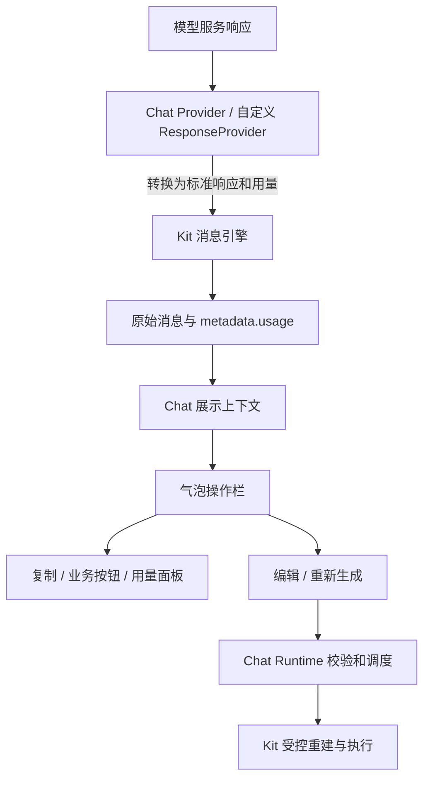

建议将两份方案合并为：**Chat 提供按角色配置的气泡操作栏；Provider 统一用量格式，Kit 保存消息数据；编辑和重新生成通过 Runtime 执行，业务通过按钮与插槽扩展。**

以下为确认后的设计基线。**新增类型、配置、插槽和 Runtime 动作尚未实现；本文只记录方案，不代表已实现或已发布能力。**

**1. 设计目标与当前状态**

| 能力 | 最终目标 | 当前源码情况 |
|---|---|---|
| 用户气泡操作 | 默认复制、编辑 | 尚无统一操作栏及编辑动作 |
| 助手气泡操作 | 默认复制、重新生成 | 尚无统一操作栏及重新生成动作 |
| 业务按钮 | 配置反馈、菜单等操作 | 当前可通过已有插槽自行实现 |
| 操作栏显隐 | 最新常驻，历史 hover，支持自定义条件 | 待增加 |
| 用量接收 | 支持标准格式和显式转换 | 内置 Provider 已有 `includeUsage`，无转换回调 |
| 用量保存 | 保存到原始助手消息 | 当前工作区已有 usage-only 保存补丁 |
| 用量展示 | 可配置触发器及标准面板 | 当前只有应用展示片段，无通用组件 |
| 自定义响应 | 业务自行适配协议 | 已有 `ResponseProvider` 入口 |

当前依据为 TinyRobot 分支 `docs/trchat-genui-best-practice`，HEAD `df2c0ab3662e52612d36583b2815f2fa6b02fd7d` 加既有工作区补丁。上述已有能力不等于已发布包能力。

首版内置编辑和重新生成只覆盖最新回合、配置可恢复、能够确认本次执行不启用工具的纯文本路径。外部 Runtime 可显式提供自己的执行能力；附件重建、工具副作用重放、历史分支和完整请求复现不属于内置首版范围。

**2. 整体职责和数据流**



| 层级 | 职责 |
|---|---|
| Bubble 基础组件 | 内容、布局、分组、插槽 |
| Chat 操作栏 | 操作配置、条件判断、按钮状态、弹层交互 |
| ChatUI | 展示能力数据、维护独立编辑草稿、发出操作意图 |
| Chat Runtime adapter | 将 Runtime 状态投影为 UI 能力，接收操作事件并调度 Runtime |
| Chat Provider | 请求参数和响应协议适配、用量转换 |
| Chat Runtime | 定位操作目标，校验能力，恢复回合配置，调度执行 |
| Kit | 保存消息、维护执行状态，提供必要的受控重建能力 |
| 应用 | 反馈接口、业务权限、自定义 UI 和工具重放策略 |

**操作栏不直接修改消息数组；Kit 不维护厂商字段映射；面板不识别厂商协议。**

---

**3. 配置入口与默认行为**

统一放入现有 `ui.bubble.actions`。

为避免已有 footer 中的业务按钮突然重复，推荐采用显式开启规则：

| 配置 | 行为 |
|---|---|
| 未配置 `actions` 或设为 `false` | 保持当前界面 |
| `actions: {}` | 开启默认操作栏 |
| 未配置某个角色 | 使用该角色默认项 |
| 角色配置为 `false` 或空数组 | 隐藏该角色操作栏 |
| 角色配置为数组 | 按数组完整指定操作和顺序 |
| 角色配置为函数 | 基于默认项动态调整 |
| 所有项均被隐藏 | 不渲染空操作栏 |

默认项：

```ts
user: ['copy', 'edit']
assistant: ['copy', 'regenerate']
```

这是默认配置清单，实际渲染仍受能力限制：

- Runtime 未提供编辑或重新生成能力时，隐藏对应入口。
- 操作暂时不可用，例如生成中，显示为禁用。
- 用量必须显式加入 `'usage'` 才开启。

完整配置示例：

```ts
const ui = {
  bubble: {
    actions: {
      visible: true,

      display: ({ isLatest }) =>
        isLatest ? 'always' : 'hover',

      user: ['copy', 'edit'],

      assistant: (defaults) => [
        ...defaults,
        {
          type: 'custom',
          id: 'like',
          label: '点赞',
          icon: LikeIcon,
          visible: ({ turnState, message }) =>
            (turnState === 'completed' || turnState === 'unknown') &&
            typeof message.content === 'string' && Boolean(message.content.trim()),
          active: ({ messageId }) =>
            Boolean(messageId && feedback[messageId] === 'like'),
          onClick: submitLike,
        },
        {
          type: 'custom',
          id: 'dislike',
          label: '点踩',
          icon: DislikeIcon,
          visible: ({ turnState, message }) =>
            (turnState === 'completed' || turnState === 'unknown') &&
            typeof message.content === 'string' && Boolean(message.content.trim()),
          active: ({ messageId }) =>
            Boolean(messageId && feedback[messageId] === 'dislike'),
          onClick: submitDislike,
        },
        'usage',
      ],

      usage: {
        trigger: 'click',
      },
    },
  },
}
```

其中图标、反馈状态和提交函数由应用提供。配置解析函数同步执行；异步业务数据先存入响应式状态。反馈示例允许有正文的 `unknown` 历史回答，避免旧历史缺少回合记录时入口消失；多模态正文由应用调整条件。提交反馈还须有业务可定位的消息标识，不能使用对象身份代替持久目标。

**4. 操作配置类型**

保持字符串简写和三类对象，不增加注册中心或插件系统。

```ts
type BuiltinActionId =
  | 'copy'
  | 'edit'
  | 'regenerate'
  | 'usage'

type ActionCondition =
  | boolean
  | ((context: ChatBubbleActionContext) => boolean)

type ActionDisplay = 'always' | 'hover'

interface ActionPresentation {
  visible?: ActionCondition
  disabled?: ActionCondition
}

type ChatBubbleActionItem =
  | BuiltinActionId
  | (ActionPresentation & {
      type: 'builtin'
      id: BuiltinActionId
      label?: string
      icon?: ChatIcon
    })
  | (ActionPresentation & {
      type: 'custom'
      id: string
      label: string
      icon?: ChatIcon
      active?: ActionCondition
      onClick: (
        context: ChatBubbleActionContext,
      ) => void | Promise<void>
    })
  | (ActionPresentation & {
      type: 'slot'
      id: string
    })

type ChatBubbleRoleActions =
  | false
  | readonly ChatBubbleActionItem[]
  | ((
      defaults: readonly ChatBubbleActionItem[],
      context: ChatBubbleActionContext,
    ) => false | readonly ChatBubbleActionItem[])

interface ChatBubbleActionsOptions {
  visible?: ActionCondition

  display?:
    | ActionDisplay
    | ((context: ChatBubbleActionContext) => ActionDisplay)

  user?: ChatBubbleRoleActions
  assistant?: ChatBubbleRoleActions

  copy?: {
    getText?: (context: ChatBubbleActionContext) => string
  }

  usage?: {
    trigger?: 'click' | 'hover'
    resolve?: (
      context: ChatBubbleActionContext,
    ) => ChatTokenUsage | undefined
  }
}
```

约束：

- ID 在同一操作栏内唯一，自定义项不得占用内置 ID。
- 字符串 `'copy'` 等价于 `{ type: 'builtin', id: 'copy' }`。
- 内置动作不能通过 `onClick` 覆盖执行逻辑。
- 完全替换内置行为时，移除原项，再添加自定义项。
- 函数不得产生请求、修改消息或注册监听等副作用。

**5. 操作上下文和消息定位**

操作上下文使用原始消息数据，不依赖 Bubble 展示对象是否保留 metadata。

| 字段 | 含义 |
|---|---|
| `conversationId` | 会话标识；纯展示模式可能缺失 |
| `messageId` | 代表消息的持久标识，可能缺失 |
| `messageKey` | 当前渲染范围内的消息标识 |
| `message` | 当前代表原始消息，只读 |
| `messages` | 当前展示气泡关联的原始消息，只读 |
| `userMessageId` | 能可靠定位时提供的关联用户消息标识 |
| `isLatest` | 是否为最后一个可见对话气泡 |
| `isLatestUser` | 是否包含最新用户输入 |
| `isLatestAssistant` | 是否为最新助手回答气泡 |
| `turnState` | 所属回合状态，无法判断为 `unknown` |
| `capabilities.canEdit` | 当前是否允许编辑提交 |
| `capabilities.canRegenerate` | 当前是否允许重新执行 |

状态名称沿用现有 `idle / processing / completed / paused / aborted / error`，不另建一套 `failed` 状态。

定位规则：

1. 使用当前分组的 `messageIndexes` 关联同一份原始消息集合。
2. 单条用户消息组使用该消息；包含多条用户消息时，以最新用户消息作为代表，仅当它也是可操作的最新回合目标时开放编辑，不能将合并正文作为一条输入提交。
3. 助手组选择最后一条助手消息作为代表，不能选择最后一条 tool 消息。
4. 混合多个回合且无法确定归属时，关闭历史修改能力。
5. 下标仅用于当前展示映射，不作为异步操作的持久目标。

当前身份工具支持 `renderKey`、`id` 和对象身份回退。**对象身份回退只适合渲染，不能保证刷新、对象替换后的历史操作定位。**

内置 Runtime 应为可操作消息生成并持久化稳定 ID；外部 Runtime 无稳定 ID 时，仍可复制和展示用量，但不开放编辑、重新生成。

**持久身份和回合状态**：

- 新增身份、关联用户消息 ID 和回合状态放入消息 `metadata` 的专用区域，具体字段名在实现时确定；不增加默认可能被序列化到模型请求的顶层内部字段。
- 已有稳定 `id` 可作为外部定位来源，新增内置记录必须与其映射一致；渲染身份解析同时支持专用 metadata 标识，不生成互相冲突的双重身份。
- 内置 Runtime 通过 Kit 的开始、暂停、恢复、错误、取消和结束路径更新回合状态。结合 `onError`、`onFinally` 等钩子，不能只依赖 `onTurnEnd`；`onFinally` 在暂停时也会执行，不能把暂停误记为完成。
- 执行态为 `processing / paused`，终态为 `completed / error / aborted`。旧历史缺少可靠记录时使用 `unknown`，不能用当前会话请求状态代替历史回合状态。
- 这些字段随消息持久化，不另建一份消息列表或历史状态仓库。存储适配器必须保留该 metadata；外部消息没有记录时不猜测。
- hover、弹层开关、按钮 loading、执行锁和历史版本是运行时状态，不持久化。
- 旧历史仍可复制和展示有效用量；编辑与重新生成须额外验证目标、配置及能力，不因补齐 ID 就自动开放。

**6. 显示、显现和禁用**

| 配置 | 控制内容 |
|---|---|
| `visible` | 操作栏或操作项是否存在 |
| `display` | 已存在的操作栏何时显现 |
| `disabled` | 已显示的操作能否执行 |

最终规则：

```text
可见 =
操作栏允许显示
∩ 操作项允许显示
∩ 内置动作存在且满足必要数据条件

可执行 =
可见
∩ 业务未禁用
∩ Runtime 当前允许
∩ 操作未在执行
```

业务设置 `visible: true` 不能让无数据的用量按钮出现，设置 `disabled: false` 不能绕过 Runtime 校验。

交互约定：

- 默认最新气泡常驻，历史气泡 hover 显示。
- hover 范围是整个气泡。
- 键盘进入相关区域时显示。
- 无 hover 能力的触屏设备常驻显示。
- 菜单或面板打开期间保持显示。
- 历史气泡的 hover 切换保留栏位，避免布局跳动。
- 业务隐藏、无操作项时不保留空白。
- 优先使用 CSS hover、focus-within，不给每条历史消息注册鼠标移动状态。

**7. 内置动作语义**

| 动作 | 行为 |
|---|---|
| 用户复制 | 复制当前用户输入正文 |
| 助手复制 | 复制当前回答气泡中的正文 |
| 用户编辑 | 打开独立草稿，提交后重新执行最新回合 |
| 助手重新生成 | 保留原用户输入，重新执行最新回合 |
| 用量 | 打开代表助手消息对应的单次请求用量 |

复制不包含隐藏 system、推理过程、工具参数、内部工具结果和附件地址。

默认从正文文本内容提取。复杂渲染通过 `copy.getText(context)` 调整文本提取，无需替换复制按钮。空文本时禁用，剪贴板失败时不能显示成功。

编辑使用独立草稿：

- 取消不修改历史。
- 不覆盖主输入框已有草稿。
- 切换会话后关闭编辑器，旧提交不能作用于新会话。
- 首版内置只编辑纯文本输入，保留原用户消息身份及可恢复的回合配置；含附件、外部 payload 或自定义消息构造的路径不自动开放。
- 首版仅编辑最新回合；不实现历史分支、附件重建和版本切换。外部 Runtime 可显式实现其他输入形式。

**8. 重试与重新生成统一，但执行必须受控**

只提供一个 `regenerate` 动作：

| 状态 | 默认文案与行为 |
|---|---|
| `completed` | 重新生成 |
| `error` | 重试 |
| `aborted` | 重试 |
| `processing`、`paused` | 禁用 |
| `idle`、`unknown` 或归属不明确 | 默认不开放，除非外部 Runtime 能明确验证执行目标 |

“重试”表示重新执行原回合，不表示从失败步骤继续。

建议在现有 Runtime 上增加可选能力：

```ts
interface ChatMessageActionTarget {
  conversationId: string
  userMessageId: string
}

// 建议新增到现有 Runtime 能力中。
getMessageCapabilities(target): {
  canEdit: boolean
  canRegenerate: boolean
}

// 建议新增到现有 Runtime actions 中。
editMessage(target & { text: string }): Promise<boolean>
regenerate(target): Promise<boolean>
```

以上是接口轮廓；目标始终绑定会话与用户消息，不绑定 Markdown 分片或当前活动下标。

Runtime 是否实现对应动作表示“支持”；`canEdit / canRegenerate` 表示“当前可执行”。动作缺失时隐藏，暂时不可执行时禁用，目标不属于支持范围时隐藏。业务的 `disabled: false` 不能提升 Runtime 能力。能力查询必须使用响应式状态，点击后仍需重新校验。

共同执行流程：

```text
捕获目标、引擎、会话导航版本及历史版本
→ 在任何异步业务检查前占用会话执行锁
→ 校验最新回合、模型、输入形式及执行状态
→ 读取原回合配置，检查当前权限
→ 执行必要的业务审批
→ 再次检查会话、引擎、目标、版本和权限
→ Kit 同步接受并受控重建回合
→ 开始新尝试，沿用现有执行生命周期
→ 在 finally 中释放执行锁
```

必须保证：

- 不重复添加用户消息。
- 不直接复用默认 `send` 导致采用当前选中的模型配置。
- 原模型、配置或输入不可恢复时明确拒绝。
- 校验被拒绝前保留原历史。
- 不留下孤立 tool 消息或待确认状态。
- 新尝试不继承旧回答的 usage、错误和反馈。
- 引擎接受并提交回合替换之后，初始化插件失败、请求失败和取消均按新尝试处理，不承诺自动恢复旧回答。
- 不增加回答分支管理。

**首版只开放能够确认本次执行不会启用工具的纯文本路径。** “原回合没有调用工具”本身不够，因为重新生成仍可能发起工具调用；仅检查 MCP 是否开启也不够，还需考虑其他工具入口。不能仅因注册了 Skill 就禁止，应依据其实际执行能力；不能可靠判定时不开放。首版不自动关闭工具后重放，也不追溯禁止此前历史中已有的完整工具结果。

**8.1 Kit 受控重新执行契约**

当前 `send()` 会追加消息，空 `send()` 也不能为原用户消息正确建立 `currentTurn`。因此需要最小的受控重新执行入口；具体 API 名称和参数在实现时确定，不开放应用自行截断历史的方案。

1. 接收当前引擎中的目标用户消息和可选替换正文；内部同步验证对象/身份仍匹配、目标是最后一个用户回合、引擎可启动。
2. 保留目标之前的历史。重新生成保留原用户消息；编辑仅替换正文，保留用户消息稳定身份和经校验的配置，清理该输入因内容变化失效的业务结果。
3. 在一次受控历史更新中移除目标之后的旧回答及回合附属消息，不保留孤立 tool、待确认状态或旧回答反馈。
4. 以目标用户消息重建 `currentTurn`，创建新执行标识、AbortController 和干净的插件上下文；不沿用旧暂停或工具确认状态。
5. 重新执行 `onTurnStart` 等现有完整生命周期，确保原配置读取插件能取得目标用户消息；新回答使用新消息身份，不继承旧回答用量、错误和反馈。
6. 通过引擎受控更新发布消息和请求状态通知，保证 Vue、订阅者及持久化看到一致结果。锁和历史替换在执行任何异步钩子前完成同步检查。

Kit 负责执行一致性，Chat 负责最新回合策略、模型权限及业务审批；不在 Kit 中加入模型选择、厂商映射和业务权限逻辑。Kit 也必须拒绝引擎状态不允许的执行，不能只依赖 UI 禁用。

| 边界 | 历史行为 |
|---|---|
| 目标校验、配置校验或业务审批拒绝 | 原历史完全保留 |
| 引擎同步接受并提交回合替换 | 旧回答被替换，新尝试开始；不以 HTTP 是否发出为界 |
| 新尝试初始化失败、请求失败或取消 | 保留新尝试的错误或取消状态，不自动恢复旧回答 |

`Promise<boolean>` 表达是否执行：校验或审批拒绝为 `false`，正常执行返回 `true`；异常按既有 Runtime 错误通道处理，取消以消息状态表达。`true` 不表示模型回答成功，不能据此替代消息终态。

**8.2 会话执行锁与过期检查**

- 发送、编辑提交和重新生成共享同一会话执行锁，复用现有发送占位机制；不能按操作 ID 各自加锁。
- 在异步审批前占位；审批返回后复查会话导航版本、引擎、目标身份和历史版本。切换出去再切回来也属于过期操作。
- 稳定 ID 只保证定位，不证明正文未变化。会话维护运行时历史版本，在消息历史发生相关变更时递增；编辑草稿捕获打开时版本，提交时拒绝已过期目标。此版本不持久化。
- 清空、删除会话使待审批操作失效；不能因异步审批结束而重新创建目标会话。执行锁不阻止复制、查看用量、本地草稿、会话导航和已有取消操作。
- 运行中会话被删除或清空时，沿用对应资源清理和取消流程；旧操作不能向新引擎写回结果。所有退出路径释放其实际占用的锁。

**8.3 原配置恢复范围与业务检查**

首版“恢复原配置”指：使用消息保存的模型 ID 和功能选择，在当前模型定义和当前权限下执行。现有 `ChatRunConfig` 不等于完整请求快照。

- 不采用界面当前选中的其他模型；模型已移除、禁用，或原选项无法解释时拒绝，不静默切换或回退默认值。
- 不承诺服务端参数、系统提示词或插件实现与历史时刻完全一致；不在消息中保存 API Key、请求头等凭证。
- 附件、外部 payload、自定义 `send` 或缺少可靠配置的旧消息，不自动获得内置重放能力；外部 Runtime 显式提供动作和能力后再接入。
- 发送审批与重放审批必须区分操作类型。不得直接调用可能包含发送计数、附件上传等副作用的 `beforeSend`；需要审批的应用应提供可选的消息操作检查入口，携带编辑/重新生成类型、原目标及候选输入，明确返回允许或拒绝。
- 消息操作审批发生在历史替换之前；普通通知事件只观察结果，不能再次触发执行。检查入口不承担实际发送，避免出现审批和 Runtime 双重执行。

当前错误插件已经会在没有助手消息时补充助手错误消息，应复用该路径承载重试；外部 Runtime 未提供助手错误消息时，再由展示层提供错误区域，避免重复错误记录。

**9. 用量的统一协议与类型衔接**

推荐统一使用现有字段名称：

```ts
interface TokenUsage {
  prompt_tokens?: number
  completion_tokens?: number
  total_tokens?: number
}

type ChatTokenUsage = Readonly<TokenUsage>
```

这里需要补齐此前草案没有解决的类型问题：

**当前 Kit 的响应契约依赖 OpenAI 类型，usage 通常要求三个字段齐全；面板希望支持部分字段，不能通过补零或强制断言衔接。**

建议最小调整：

- Kit 定义上述轻量用量类型。
- 项目自己的消息响应类型沿用现有响应结构，仅将 `usage` 放宽为该类型或 `null`。
- 原标准 OpenAI 响应仍然合法。
- 相关 Provider、钩子的响应类型同步引用。
- 不修改第三方 OpenAI 类型，不直接改造旧兼容导出的 `Usage` 接口。
- Kit 的运行时仍只保存数据，不增加厂商转换逻辑。

这是公共响应类型的调整，不是“输入可接受旧 OpenAI 响应就完全向后兼容”：钩子和 Provider 消费方今后必须处理用量字段缺失。发布说明须记录此变化，类型检查覆盖标准 OpenAI Provider、自定义部分用量 Provider、插件和回调；同步调整泛型约束，不能用强制断言绕过。旧兼容导出保持原义。

Chat 复用该类型，并共用一个校验函数供 Provider 和面板使用，避免两套校验规则。

面板校验规则：

| 输入 | 结果 |
|---|---|
| 至少一个标准字段有效，其余已提供标准字段也有效 | 展示 |
| `0` | 有效 |
| 部分字段缺失 | 对应位置显示 `—` |
| 空对象、`null`、非对象 | 隐藏 |
| 标准字段为负数、小数、非有限数或非数字 | 隐藏 |
| 额外字段 | 不参与展示 |

不隐式转换字符串，不估算，不补零，不通用推导总量。

**10. Provider 转换入口：`mapUsage`**

建议放在现有 `ChatProviderModelConfig`，与 `includeUsage` 同级，不同时增加多层覆盖配置。

```ts
interface ChatUsageMapContext {
  readonly modelId: string
  readonly chunk: unknown
}

type ChatUsageMapper = (
  usage: unknown,
  context: ChatUsageMapContext,
) => ChatTokenUsage | undefined
```

建议配置：

```ts
const modelProviders = [
  {
    type: 'openai',
    models: [
      {
        id: 'my-model',
        label: '业务模型',
        includeUsage: true,
        mapUsage: normalizeMyServiceUsage,
      },
    ],
  },
]
```

`includeUsage` 与 `mapUsage` 职责独立：前者请求用量，后者转换已收到的数据，配置转换函数不能保证服务端一定返回用量。

处理规则：

| 情况 | 行为 |
|---|---|
| 未配置 mapper | 使用标准 `chunk.usage` |
| 配置 mapper | 以返回值作为当前块的标准用量 |
| 返回 `undefined` | 当前块不更新用量 |
| 返回无效数据 | 忽略该次用量更新 |
| mapper 抛错 | 隔离转换异常，文本和工具响应继续处理 |
| 当前块没有 usage，但私有位置有数据 | mapper 可通过 `context.chunk` 提取 |
| 完全不同的流协议 | 使用自定义 `ResponseProvider` 转换完整协议 |

补充约定：

- mapper 同步执行，在解析后的响应块上调用，覆盖最终 usage-only 块。
- mapper 已配置却返回 `undefined` 时，不自动回退原始 usage，避免违背主动忽略的意图。
- 每个有效结果按完整快照替换，不跨块相加或自动补全。
- 当前块无结果，不清除本次请求先前保存的有效用量。
- Provider 无有效更新时移除输出块的 `usage` 属性，不能保留原始私有用量或写入 `undefined`；mapper 抛错、无效、主动忽略都遵循此规则。
- Kit 对普通块和 usage-only 块使用一致的保存语义：缺失、`null`、`undefined` 不覆盖已有有效用量。当前普通块的 metadata 合并路径必须避免 `Object.assign` 将空 usage 覆盖进去；这项保护同样覆盖自定义 Provider。
- 每次重新生成的新回答从空用量开始；“保留先前有效用量”仅限同一次模型请求，不跨请求或跨尝试。
- 默认标准路径保留已有额外字段，面板只读取三项。
- 转换异常提供受限开发诊断，不记录完整响应，不把文本请求标记为失败。
- 不使用 `onCompletionChunk` 作为统一入口，因为当前 usage-only 路径会跳过它。

例如，已确认统计语义一致的服务可以显式转换：

```text
input_tokens   → prompt_tokens
output_tokens  → completion_tokens
total_tokens   → total_tokens
```

**11. 面板读取入口：`usage.resolve`**

正常数据路径：

```text
Provider 转换
→ metadata.usage
→ 面板直接读取
```

外部历史或业务数据路径：

```text
业务消息元数据
→ usage.resolve
→ 面板校验和展示
```

默认读取代表助手消息的：

```ts
context.message.metadata?.usage
```

自定义示例：

```ts
usage: {
  trigger: 'click',
  resolve: normalizeHistoricalMessageUsage,
}
```

规则：

- 未配置 resolver：读取默认位置。
- 配置 resolver：以其结果为准，不自动回退。
- 返回 `undefined`、无效结果或抛错：不展示入口。
- resolver 同步、无副作用。
- 结果仅供展示，不反写消息或持久化。
- 不要求已经通过 Provider 归一化的数据再次转换。

**`mapUsage` 解决接入与存储格式；`usage.resolve` 解决展示数据来源。**

**12. 用量范围和弹层交互**

一个回合可能包含多次模型请求，一个气泡也可能合并多条消息。因此首版只展示：

> 代表助手消息对应的单次模型请求用量。

不遍历整组相加，不称为“本回合总量”，代表消息没有用量时也不悄悄借用上一条请求的数据。

面板默认关闭：

```text
本次模型请求用量

输入 Token    1,200
输出 Token      350
总计 Token    1,550
```

交互规则：

| 场景 | 行为 |
|---|---|
| 未配置 `'usage'` | 无入口 |
| 配置但无有效数据 | 无入口 |
| 有效数据 | 显示带可访问名称的图标按钮 |
| 点击模式 | 点击切换，外部点击或 Escape 关闭 |
| hover 模式 | 进入触发器打开，进入面板保持，离开后关闭 |
| 键盘 | 可以打开、访问和关闭 |
| 触屏 hover | 退化为点击 |
| 切换会话、消息移除或代表消息改变 | 关闭 |
| 原目标数据更新 | 更新内容 |
| 数据失效 | 关闭并隐藏入口 |

面板应支持文本选择、视口边缘定位和容器裁剪处理。可交互的面板不按纯 tooltip 实现，优先复用项目已有弹层能力。

取消或断流时可能没有最终用量；已收到的实际用量可以保留，缺失值不能补成零。

**13. 业务按钮、插槽与异步状态**

普通按钮由 Chat 负责点击、防重入、禁用和 Promise 状态；反馈结果由应用更新。

复杂交互采用：

```ts
{
  type: 'slot',
  id: 'business-feedback',
}
```

建议新增 `bubble-action` 作用域插槽，提供：

```ts
{
  item,
  context,
  disabled,
  setOpen,
}
```

其中：

- 只渲染 `type: 'slot'` 项。
- `setOpen(true)` 为该项保持操作栏显示。
- `setOpen(false)` 释放该项状态。
- 多个项分别管理，关闭一个不能影响其他项。
- 卸载时自动清理。
- slot 内部表单、请求、焦点和禁用行为由业务负责。

自定义按钮的异步状态按“会话＋消息标识＋操作 ID”隔离；此处是按钮防重入，不替代第 8.2 节的会话执行锁。无持久消息 ID 时只对当前渲染实例隔离，不能用于历史修改或业务结果持久写回。

```text
点击
→ 重新校验
→ 占用当前按钮状态
→ 执行一次
→ 成功或失败反馈
→ 释放
```

旧请求不能更新新会话的按钮状态。自定义业务请求仍由业务管理取消和结果写入目标，Chat 不假设卸载就能中止它。

通知事件只承担观察职责，不再次执行回调。Runtime 操作错误沿用现有错误通道；UI 和业务按钮错误使用对应操作错误通知，避免同一失败重复提示。

**14. 分组、插槽兼容与组件边界**

操作栏渲染在展示气泡末尾，一组只出现一次；不能放在每个 `content-footer` 分片中。

- 编辑绑定用户输入，重新生成绑定原回合。
- 同一回合有多个展示组时，重新生成只放在最后一个合适位置。
- 复制面向可见气泡正文；编辑、反馈和用量须使用明确的原始代表消息。跨回合分组无法确定唯一目标时不开放历史修改。
- 原 `bubble-content-footer`、`bubble-after` 保留原行为。
- 新操作栏与已有 footer 并存；已有应用可通过配置关闭重复的内置项。
- 覆盖整个主消息区域的应用，自行决定是否使用默认操作栏。

建议源码分工：

| 位置 | 调整 |
|---|---|
| Chat UI 类型 | 操作配置、上下文、插槽与通知 |
| `ChatMessages` | 原始消息映射、代表消息、操作位置 |
| `ChatBubbleActions` | 配置解析、显隐、按钮及执行状态 |
| 用量展示组件 | 触发器、弹层与三项用量展示 |
| Chat Provider | `mapUsage` 及转换异常隔离 |
| Chat 内共享用量工具 | Provider 与 UI 共用的校验 |
| Chat Runtime adapter | 能力计算、编辑与重新生成调度 |
| Chat Runtime / 生命周期桥接 | 目标校验、会话执行锁、配置检查、持久身份和回合状态 |
| Kit 类型 | 最小用量响应类型调整 |
| Kit 引擎 | 必要的受控回合重建，不添加厂商逻辑 |

视觉部分优先复用 `IconButton`、`ActionGroup`、`Feedback`；不向基础组件注入 Chat Runtime。

新增 Vue 组件使用 Composition API、`<script setup lang="ts">`，消息状态保持单一来源，不复制维护第二份用量数据。

**ChatUI 独立接入链路**：

```text
Runtime 状态和可选动作
→ adapter 投影消息目标、支持情况及当前可执行能力
→ ChatUI / ChatMessages 渲染
→ ChatUI 发出编辑或重新生成操作意图
→ adapter 校验并调用 Runtime
```

- 能力视图通过现有 `ChatUIData.bubble` 增补，按稳定目标关联；不将 Runtime 对象或执行函数注入 Bubble 基础组件。
- ChatUI 的编辑/重新生成事件携带目标，编辑提交还携带候选正文；`TrChat` 连接 adapter，独立 ChatUI 由业务接事件并更新数据。具体事件名在类型实现时确定。
- 区分动作不支持、目标不适用和暂时禁用；adapter 负责投影，Runtime 负责最终校验。外部 Runtime 没有这些可选动作时仍兼容现有聊天。
- 编辑器只维护本地草稿和提交状态，不维护第二份消息历史；失败或拒绝时不能提前改写气泡正文。
- 新动作纳入现有 Runtime 操作错误通道，UI 不再重复执行或重复提示。

**15. 实施顺序与验收**

| 顺序 | 交付 | 验收重点 |
|---|---|---|
| 1 | 操作栏、复制、动态按钮、插槽及 ChatUI 接线 | 默认关闭、角色配置、条件、排序、异步防重入、分组不重复、独立 ChatUI |
| 2 | 用量类型衔接和 Provider 转换 | 标准路径、自定义映射、usage-only、空值不覆盖、异常隔离和类型兼容 |
| 3 | 用量触发器和面板 | 零值、缺失、非法值、click/hover、键盘及触屏 |
| 4 | Kit 受控重新执行 | 同步接受边界、用户消息不重复、currentTurn、插件生命周期、错误/取消和状态通知 |
| 5 | Chat 最新纯文本回合编辑、重新生成 | 持久身份与终态、原配置、审批拒绝、过期草稿、跨动作互斥、工具路径限制 |
| 6 | 文档与代表性应用示例 | 内置 Provider、自定义 Provider、外部 Runtime、历史消息、反馈插槽 |

第 2 步可以与第 1 步并行；第 3 步依赖前两步。第 4 步不阻塞用量交付，第 5 步依赖第 1、4 步；第 6 步随各交付补齐。此表是本方案内部实施步骤，不改动迁移台账的阶段编号。本次仅更新设计，以上步骤均未据此宣告完成。

验证复用已有流式、失败、取消生命周期测试，仅增加新行为断言。尤其覆盖：

- 内置 Provider mapper 的 usage-only 路径及抛错。
- 部分字段与类型检查，不使用补零或断言绕过。
- 普通块和 usage-only 块先有有效用量，后有缺失、`null` 或 `undefined`；新尝试不继承旧用量。
- 标准 OpenAI 响应仍可赋值，部分字段 Provider、插件和回调使用新的可选字段契约。
- 切换会话、对象替换、消息移除后的目标隔离。
- 历史刷新后身份和终态保留，旧历史为 `unknown` 时不误判当前会话状态；多用户消息分组编辑目标唯一。
- 面板打开时 hover 操作栏保持显示。
- 编辑取消不改历史，执行拒绝前不删除原回答。
- 发送、编辑、重新生成互斥；异步审批期间切换后返回、修改目标、清空或删除会话均不能提交过期操作。
- Kit 正确重建 `currentTurn` 并重新触发生命周期；原模型及选项缺失时拒绝，不使用当前选择静默回退。
- 引擎提交前拒绝保留历史；提交后初始化失败、请求失败或取消形成新尝试状态，不自动恢复旧回答。
- 无明确策略的工具回合不能重放。
- 原 footer 与自定义内容保持可用。

本次不包含工具回合重放、历史分支、整回合用量汇总和供应商细分统计。

**16. 设计依据**

| 设计点 | 依据 |
|---|---|
| 操作配置放入 Chat | [现有 UI 配置及 Sender 工具栏模式](../packages/chat/src/types/ui/options.ts) |
| 展示组映射原始消息 | [ChatMessages](../packages/chat/src/ui/messages/ChatMessages.vue)、[气泡分组](../packages/components/src/bubble/messageGroups.ts) |
| 渲染身份与持久目标分开 | [messageIdentity](../packages/chat/src/ui/messages/messageIdentity.ts) |
| 历史修改通过 Runtime | [现有 Runtime 协议](../packages/chat/src/types/runtime.ts)、[回合配置与发送实现](../packages/chat/src/runtime/useChatRuntimeFromConversation.ts) |
| ChatUI 数据与事件接入 | [ChatUI 数据协议](../packages/chat/src/types/ui/data.ts)、[ChatUI](../packages/chat/src/ChatUI.vue)、[Runtime adapter](../packages/chat/src/composables/useChatRuntimeAdapter.ts) |
| 配置恢复的实际范围 | [runConfig](../packages/chat/src/runtime/runConfig.ts)、[回合上下文插件](../packages/chat/src/runtime/plugins/runConfigContextPlugin.ts)、[请求参数插件](../packages/chat/src/runtime/provider/requestPlugin.ts) |
| Provider 处理用量转换 | [当前 Provider](../packages/chat/src/runtime/provider/responseProvider.ts)、[AI SDK 转换实现](https://github.com/vercel/ai/blob/main/packages/openai-compatible/src/chat/openai-compatible-chat-language-model.ts) |
| Kit 保存标准消息数据 | [响应类型](../packages/kit/src/message/types.ts)、[引擎保存路径](../packages/kit/src/message/core/engine.ts) |
| 复用已有错误消息路径 | [errorStatePlugin](../packages/chat/src/runtime/plugins/errorStatePlugin.ts) |
| 流式最终用量可能缺失 | [OpenAI 流式接口定义](https://github.com/openai/openai-node/blob/master/src/resources/chat/completions/completions.ts) |

角色默认按钮、显隐规则、显式开启和首版重放范围属于本项目产品设计；参考实现用于支持边界划分，不代表第三方已经提供完全相同的 API。

**17. 设计变更记录**

| 日期 | 状态 | 内容 |
|---|---|---|
| 2026-11-12 | 设计已确认，文档已补齐，功能待实现 | 明确 Kit 回合重建与提交边界、共享会话执行锁、过期目标检查、配置恢复范围、历史身份及终态、空用量不覆盖、公共类型变化、独立 ChatUI 接线与实施依赖；保留既有源码补丁，不宣告功能交付。 |
